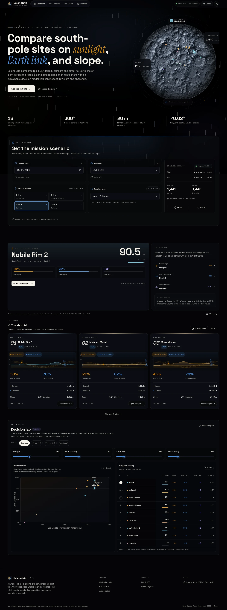
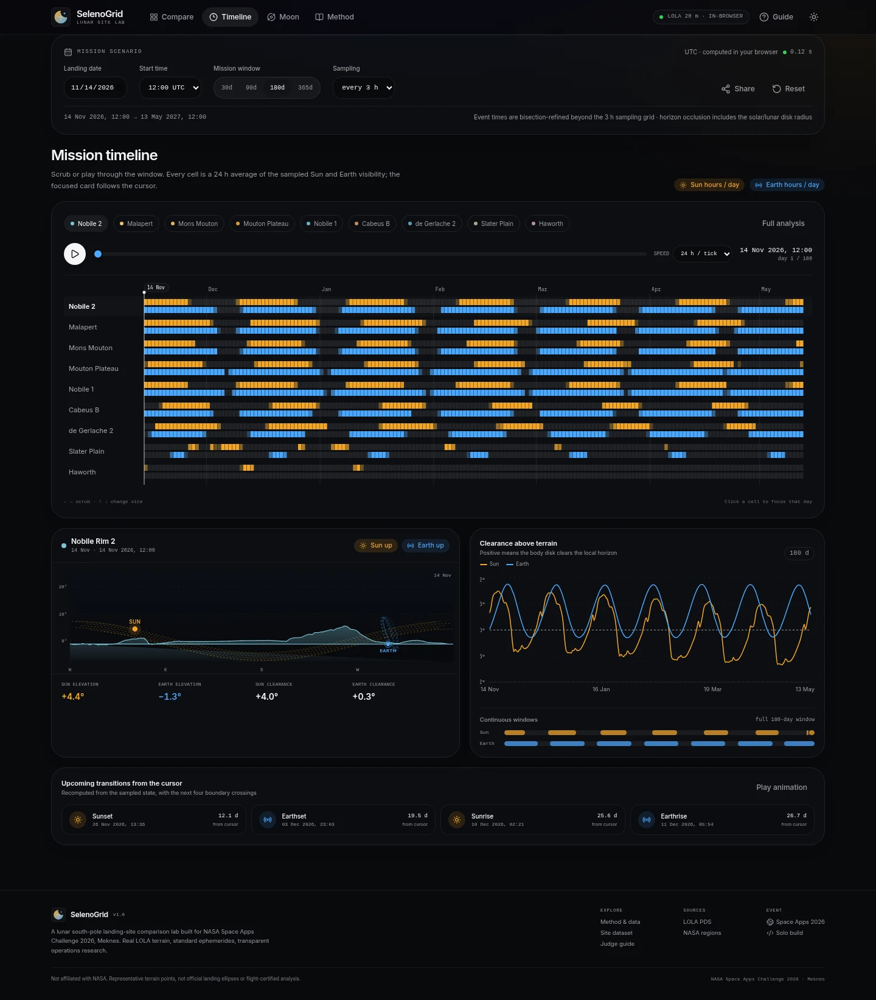
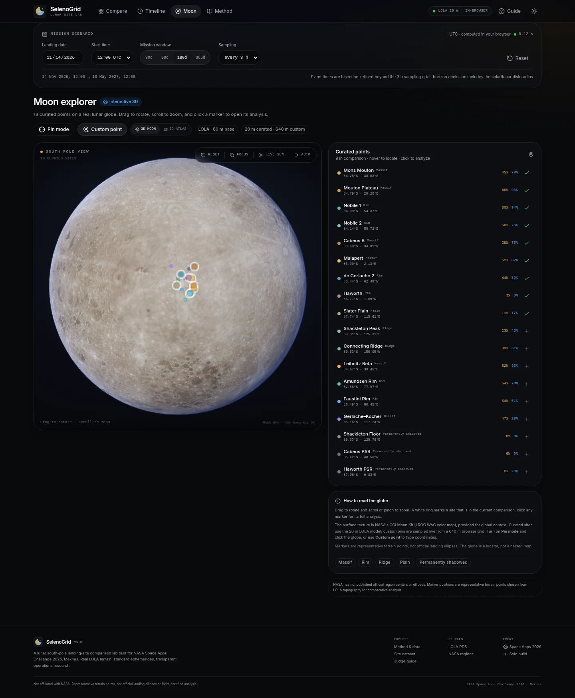
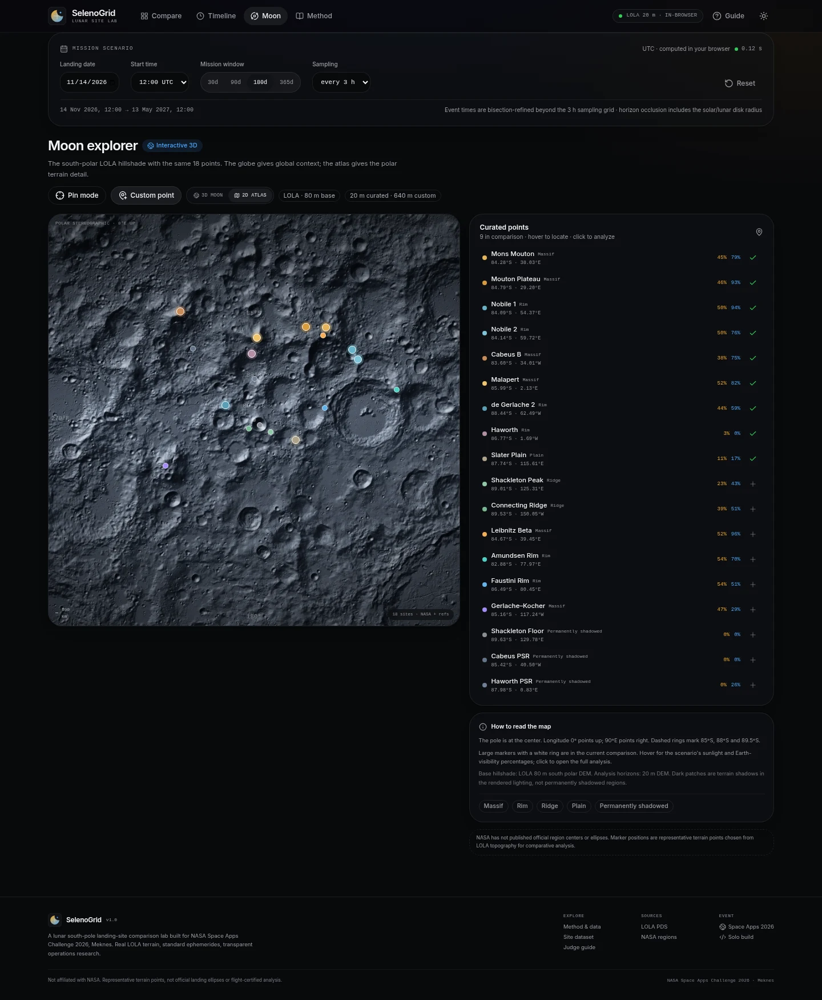
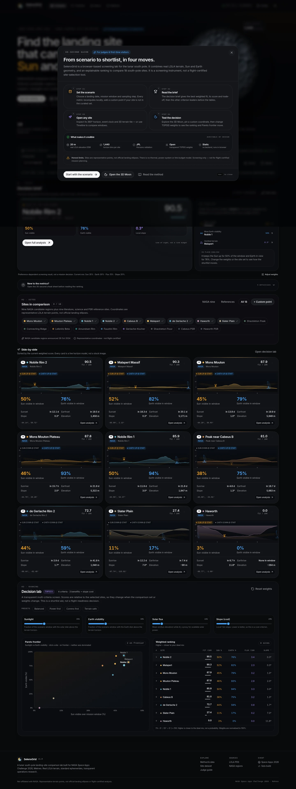

# SelenoGrid

**Compare lunar south-pole landing sites with real terrain, real Sun/Earth geometry, and math you can inspect.**

SelenoGrid is a browser-based decision-support workbench for the lunar south pole. It puts the nine NASA candidate regions announced in October 2024 and nine literature, science and PSR reference sites on the same footing. Pick a date and a mission length, then compare sunlight, Earth visibility, solar flux, slope, horizon relief, and time to the next sunset or earthset. Adjust what matters and watch the ranking and Pareto frontier respond. You can also pin any coordinate south of 80°S and analyse it live from a 640 m LOLA grid.

Built solo for NASA Space Apps Challenge 2026, Meknes (13-15 Nov 2026). Static React app. No backend. No API keys. No hidden model weights.

**[Live demo](https://hatim-a.github.io/selenogrid/)** · [Judge guide](docs/JUDGE_GUIDE.md) · [Method](docs/METHOD.md) · [Sources](docs/SOURCES.md) · [Demo script](docs/DEMO_SCRIPT.md) · [Pitch outline](docs/PITCH.md)

> **What this is not.** NASA has not published official region centres or landing ellipses for these nine regions. The coordinates in SelenoGrid are representative terrain points selected from LOLA topography, not official landing ellipses. SelenoGrid is a comparative screening aid, not a flight-certified site-selection tool.

> **Mission note.** NASA redefined Artemis III in 2026 as a low Earth orbit test flight and moved the first crewed south-pole landing to Artemis IV, targeted for 2028. The nine regions from the October 2024 announcement are used here as a public reference set for the south-pole site-selection problem, not as a claim about the current mission manifest.



## The problem

A landing site near the lunar south pole is not a pin on a map. It is a schedule. A site can be sunlit for most of a lunar day but radio-dark; another can see Earth continuously but sit on a steep slope. The Sun and Earth move slowly and unevenly across a polar horizon, so the usable windows depend on the date, the mission length, and the local terrain profile. Static illumination maps and slope maps show pieces of this. They do not let a scientist, engineer, or member of the public compare the whole trade in one place, on their own terms.

The app is deliberately answer-first: the scenario bar, decision brief, and a plain-English verdict come before the evidence. A 60-second in-app guide does the same for a first-time judge. Compare preloads the **nine NASA regions**. Open the site library from **Edit sites** or the **9 of 18 sites** button to add references, select **All 18**, or pin a custom coordinate south of 80.15°S.

SelenoGrid closes that gap with three ingredients:

1. **Real terrain.** 20 m/pixel LOLA topography and a 360 degree terrain horizon for every site.
2. **Real geometry.** Topocentric Sun and Earth positions from a Meeus/IAU astronomy engine, checked against JPL Horizons.
3. **Transparent OR.** A four-criterion TOPSIS ranking with user-adjustable weights and a sunlight-versus-Earth-visibility Pareto frontier.

## Quick start

Requires Node.js 20.19+ or 22.12+.

```bash
npm install
npm run dev       # local development server
npm run build     # type-check and produce a static dist/
npm run preview   # serve the production build locally
```

No environment variables, API keys, or database are needed. The shipped curated dataset at `public/data/sites.json` is about 1.2 MB and the custom-pin grid is 1.8 MB, so the 1.8 GB LOLA DEM is **not** required to run the app. The DEM is only needed to rebuild the terrain products.


The app opens on a scroll-driven landing story: hero, four pinned chapters, a scroll-scrubbed 180-day mission film, JPL validation, and the call into the lab. Share `?view=compare` (or timeline, moon, method) to link straight into the tool.

## Five views

| View | What it is for | What you see |
| --- | --- | --- |
| **Landing** | The scroll-driven story | Starfield hero, four pinned chapters, a scroll-scrubbed mission film, validation proof, and the call into the lab |
| **Compare** | Rank and inspect sites under one scenario | Site cards with metric summaries and 360 degree horizon panoramas, a detail dialog with an interactive 3D terrain perspective, adjustable TOPSIS weights, ranking table, and Pareto scatter |
| **Timeline** | See how visibility changes through time | Per-site daily heatmap of sunlight and Earth visibility, event markers, and a play control for temporal animation |
| **Moon** | Put the sites back on the Moon | Interactive 3D lunar globe with every site marker and hover metrics, plus a 2D south-polar LOLA hillshade for terrain context |
| **Method** | Check the reasoning | Formulas, assumptions, data provenance, validation table, and limitations, written for both expert and public readers |

| Timeline | 3D Moon | 2D Atlas |
| --- | --- | --- |
|  |  |  |

### For judges



The same route is written down in the [judge guide](docs/JUDGE_GUIDE.md).

A persistent mission-scenario builder controls the whole app. It shows the UTC start/end, sample count, and current compute state, not just a date form:

| Control | Options |
| --- | --- |
| Start date | Any date and UTC time |
| Duration | 30, 90, 180, or 365 days |
| Time step | 1, 3, or 6 hours |

Every view pairs plain-language summaries with the numbers, units, formulas, and assumptions behind them. The detail dialog and Method view carry the expert-level material; the cards and hero carry the public entry point.

## What you can do

| Capability | Detail |
| --- | --- |
| Compare 18 curated sites | Nine NASA candidate regions plus nine literature, science and PSR reference sites |
| Pin a custom coordinate | Any point south of 80.15°S, sampled live from a 640 m LOLA grid with its own horizon and local terrain tile |
| Explore the Moon in 3D | Interactive LROC-textured globe with all curated markers, hover metrics, rotate/zoom, and links into each site |
| Compare dates | Change the scenario start and duration; all metrics and rankings recompute |
| Read a horizon | 1,440-bin (0.25 degree) terrain horizon per site, with the elevation and distance of the blocking ridge |
| Share a scenario | The **Share** button copies a link containing the view, date, window, site set and TOPSIS weights |
| Check power potential | Sunlight percentage, mean solar flux proxy, longest continuous sun window, next sunset and sunrise |
| Check communications | Earth visibility percentage, longest continuous Earth window, next earthset and earthrise |
| Check terrain | Local slope, aspect, open-sky fraction, horizon relief, a 200 x 200 terrain tile at 60 m/pixel, and an interactive 3D perspective of the tile |
| Rank with OR | TOPSIS with four adjustable weights: sunlight, Earth visibility, solar flux, and slope (cost) |
| See trade-offs | Pareto frontier of sunlight versus Earth visibility, with dominated sites marked |
| Learn the method | In-app formulas, validation numbers, and a limitations list |

Slope is a **cost** criterion: a lower slope produces a better score. The other three are benefit criteria. Weights are normalized before scoring, and the ranking is a preference-dependent screening result, not an objective truth.

## Data

The terrain product is the NASA/GSFC LRO LOLA south polar DEM `ldem_80s_20m` from the PDS Geosciences Node:

- 30,400 x 30,400 pixels, 20 m/pixel, int16 little-endian
- 0.5 m per DN, referenced to a 1,737.4 km sphere
- no-data value `-32768`
- 80 degrees south to the pole, polar stereographic
- source: <https://pds-geosciences.wustl.edu/lro/lro-l-lola-3-rdr-v1/lrolol_1xxx/data/lola_gdr/polar/img/>

The Moon explorer globe uses the NASA SVS **CGI Moon Kit** 2K LROC WAC color texture (`public/data/moon-2k.jpg`) for global context. The texture is optimized for visualization, not science; it feeds no sunlight, visibility, or ranking calculation. Curated values still come from the 20 m LOLA horizons and the ephemeris.

### Custom coordinates

Open **Moon → Custom point**, or **Compare → + Custom point**. You can enter a latitude/longitude or turn on **Pin mode** and click the globe or the 2D atlas. The point is sampled live from `public/data/polar-dem-640m.bin`, a 950 × 950, 640 m/pixel south-polar grid (8× downsample of the LOLA 80 m product). The browser computes elevation, slope, a 1,440-bin horizon, Sun/Earth windows, and a local 3D terrain tile.

This is deliberately a **screening** path: curated sites use 20 m terrain, custom pins use 640 m terrain. Any custom point south of 80.15°S is allowed; it is not an official landing ellipse or a flight-certified analysis.

The 18 representative points are:

| Site | Kind | Lat (deg) | Lon (deg E) | Elevation (m) | Local slope (deg) |
| --- | --- | ---: | ---: | ---: | ---: |
| Mons Mouton | NASA region | -84.2820 | 38.0348 | 5848.5 | 1.02 |
| Mons Mouton Plateau | NASA region | -84.7906 | 29.1957 | 5321.9 | 1.99 |
| Nobile Rim 1 | NASA region | -84.0918 | 54.3699 | 1847.0 | 2.98 |
| Nobile Rim 2 | NASA region | -84.1386 | 59.7200 | 1458.3 | 0.29 |
| Peak near Cabeus B | NASA region | -83.6044 | -34.0142 | 5682.8 | 1.29 |
| Malapert Massif | NASA region | -85.9853 | 2.1289 | 5170.5 | 0.27 |
| de Gerlache Rim 2 | NASA region | -88.4407 | -62.4873 | 1040.1 | 1.70 |
| Haworth | NASA region | -86.7700 | -1.6886 | -264.2 | 11.81 |
| Slater Plain | NASA region | -87.7360 | 115.6100 | -90.1 | 7.04 |
| Peak near Shackleton | Reference | -89.0051 | 125.3093 | 1181.9 | 2.55 |
| Connecting Ridge | Reference | -89.5343 | -150.0523 | 1652.5 | 3.68 |
| Leibnitz Beta Summit | Reference | -84.6667 | 39.4548 | 7023.4 | 1.95 |
| Amundsen Rim | Reference | -82.8833 | 77.9734 | 4262.4 | 6.38 |
| Faustini Rim A | Reference | -86.4867 | 80.4514 | 1175.2 | 2.50 |
| de Gerlache–Kocher Massif | Reference | -85.1635 | -117.2391 | 3387.7 | 1.56 |
| Shackleton Crater Floor | Reference | -89.6300 | 129.7800 | -2748.2 | 6.27 |
| Cabeus Crater Floor (LCROSS) | Reference | -85.4200 | -40.5000 | -3926.8 | 9.53 |
| Haworth Crater Floor PSR | Reference | -87.9833 | 0.8333 | -3956.0 | 1.58 |

These are representative points, not the centres of official ellipses. The nine reference sites are included because they are widely discussed in the literature or are important PSR/volatile benchmarks, and they give the NASA regions a familiar comparison set. The Mons Mouton Plateau point is near the intended IM-2 / Athena landing area. IM-2 touched down in March 2025 about 400 m from its intended site and ended on its side; that outcome does not validate or invalidate this representative point.

The elevation range across the 18 points is 7,023.4 m to -3,956.0 m relative to the reference sphere. Local slopes range from 0.27 to 11.81 degrees. These are properties of the sampled points, not regional averages.

## Method at a glance

**Ephemeris.** Geocentric Sun and Moon positions follow Meeus, *Astronomical Algorithms*, chapters 25 and 47 (truncated ELP-2000/82). Lunar orientation uses the IAU 2009 mean-Earth/polar-axis model. Vectors are transformed into J2000 equatorial coordinates, then into each site's local east-north-up frame. Earth direction is topocentric: it includes the site's offset from the Moon's centre.

**Terrain horizon.** For each site, `tools/horizon.c` ray-marches 1,440 azimuth bins (0.25 degrees) from 20 m out to 220 km on the 20 m DEM. Every sample uses the exact spherical elevation angle, including lunar curvature, and bilinear DEM interpolation. The maximum elevation angle in each bin becomes the horizon. The same pass computes slope and aspect from a local plane fit, open-sky fraction, horizon relief, and a 200 x 200 terrain tile at 60 m/pixel.

**Visibility rule.** A body is visible when its upper limb clears the terrain horizon:

```text
center elevation + angular radius > terrain horizon at that azimuth
```

The Sun's angular radius is about 0.27 degrees; Earth's is about 0.9 degrees. The rule is deliberately permissive about declaring a site dark: a site is only marked Sun-dark or Earth-dark when the entire disk is below the terrain. It is not a power guarantee. Near the boundary, only a small fraction of the solar disk may be exposed, so the solar flux proxy falls to zero when the Sun's centre is below the horizon even if the upper limb is visible.

**Metrics.** Sunlight and Earth visibility percentages are sample fractions over the scenario window. Also reported: mean solar flux proxy (the positive part of `sin` of Sun elevation when visible, zero otherwise), longest continuous Sun and Earth windows, next sunset, sunrise, earthset, and earthrise, local slope, aspect, horizon relief, open-sky fraction, and elevation. Event times are refined by bisection to roughly one second. Window edges are sample midpoints, so their uncertainty is one time step.

**Ranking.** TOPSIS uses four criteria: sunlight percentage, Earth visibility percentage, mean solar flux proxy, and slope (cost). The method vector-normalizes the decision matrix, applies normalized weights, finds an ideal best and ideal worst for each criterion, and computes a closeness coefficient. The Pareto frontier is the set of sites not dominated in the sunlight-versus-Earth-visibility plane.

The full mathematics, error budget, and assumptions are in [docs/METHOD.md](docs/METHOD.md).

## Validation

The astronomy engine was compared with JPL Horizons at a Shackleton-area site (89.67 degrees south, 129.78 degrees east, h = 0) on 2026-11-14 at 12:00 UTC.

| Quantity | SelenoGrid | JPL Horizons | Difference |
| --- | ---: | ---: | ---: |
| Sun azimuth | 350.754 deg | 350.742 deg | +0.012 deg |
| Sun elevation | 1.884 deg | 1.882 deg | +0.002 deg |
| Earth azimuth | 228.316 deg | 228.314 deg | +0.002 deg |
| Earth elevation | -4.345 deg | -4.341 deg | -0.004 deg |
| Earth angular diameter | 6482.7 arcsec | 6490.5 arcsec | -7.8 arcsec |

Typical accuracy is about 0.02 degrees for Sun and Earth directions. That is fit for comparative site screening. It is not a flight dynamics product. The terrain horizon is a separate error source and is not validated here against an independent illumination product. See the error budget in the method document.

## Limitations

- No thermal model, power system sizing, battery state of charge, or solar array geometry.
- No delta-v, propellant, transport, launch window, or lander performance model.
- The solar flux proxy is the positive part of `sin(elevation)` when the Sun is visible, not integrated irradiance, and it ignores limb darkening, albedo, and panel orientation.
- No Earth-Sun radio interference, link budget, antenna pattern, or data-rate model.
- No human factors, suit constraints, dust, trafficability, or operational timeline.
- No landing ellipses, hazard maps, boulder distributions, or slope variability inside an ellipse.
- Terrain below the 20 m DEM resolution is invisible; the horizon is sampled every 30 to 120 m along each ray.
- The DEM has finite vertical accuracy and 0.5 m quantization. It is a shape product, not a certified hazard map.
- Scenario percentages are sampled, not integrated. A visibility window shorter than the chosen time step can be missed. Default steps are 3 hours; event times are refined separately.
- Representative points are not official region centres. A different point inside the same region can produce a different ranking.
- Custom pins are sampled from a 640 m browser grid, not the 20 m curated terrain, and live only for the current browser session. They are screening points, not landing-ellipse analyses. Shared links preserve curated selections; custom pins are not encoded in the URL.
- The TOPSIS weights are user preferences, not mission requirements. The ranking is sensitive to them, which is why they are exposed.
- The local terrain view is a perspective rendering of a 12 km LOLA tile, vertically exaggerated. The Moon globe is a locator textured with NASA's LROC color mosaic, not an analysis-grade terrain mesh. Neither is a landing simulation or hazard visualization.

## Challenge mapping

| Challenge ask | How SelenoGrid addresses it |
| --- | --- |
| Compare landing sites and dates | Scenario bar plus an 18-site Compare view; every metric and rank recomputes |
| Sunlight | Sun visibility percentage, mean flux proxy, longest Sun window, next sunset and sunrise |
| Earth visibility and communications | Earth visibility percentage, longest Earth window, next earthset and earthrise |
| Terrain | Slope, aspect, open-sky fraction, horizon relief, and terrain tiles |
| Time to sunset and earthset | Event clocks in the site detail dialog; event times refined by bisection |
| 2D and 3D visuals | Interactive 3D lunar globe, 2D polar atlas, 360° horizon panoramas, shaded relief, and a 3D perspective of each local terrain tile |
| Temporal animation | Timeline heatmap with play control and event markers |
| Multi-site comparison | 18 curated sites side by side, ranking table, Pareto frontier, and custom pins |
| Custom coordinates | Pin any point south of 80.15°S in the Moon explorer or Compare; it is analysed live from a 640 m browser grid. The offline 20 m pipeline remains available for high-resolution curated points |
| Expert and public accessibility | Public cards and tooltips; expert numbers, units, formulas, and assumptions |

## Accessibility

The UI is designed for keyboard navigation, visible focus, reduced-motion preferences, and non-color-only encoding. Horizon and visibility states use labels and patterns as well as color. Numeric values always carry units. Plain-language summaries avoid unexplained acronyms, while the Method view and detail dialog expose the assumptions behind every number. This is a design target, not a claim of formal WCAG certification.

## Reproducibility

```bash
# 1. Download the DEM and its label from PDS (about 1.85 GB)
#    https://pds-geosciences.wustl.edu/lro/lro-l-lola-3-rdr-v1/lrolol_1xxx/data/lola_gdr/polar/img/

# 2. Build the horizon extractor
cc -O2 -o tools/horizon tools/horizon.c -lm

# 3. Extract the curated sites
./tools/horizon data/lola/ldem_80s_20m.img 30400 20 tools/sites.raw.json tools/sites.csv

# 4. Merge machine output with human-written metadata
node tools/build_sites.mjs

# 4b. Build the 640 m browser grid for custom pins
python3 tools/build_polar_grid.py

# 5. Spot-check the astronomy engine
node --experimental-strip-types tools/check_astro2.mjs

# 6. Build the static site
npm run build
```

`tools/build_sites.mjs` reads `tools/sites.raw.json` and `tools/sites-meta.json` and writes `public/data/sites.json`. The DEM itself is not part of the static bundle. A custom site requires a new row in `tools/sites.csv`, a rerun of the C extractor, and a rerun of the merge script. There is no server-side compute and no API call.

## Stack

React 19, Vite 8, TypeScript, Tailwind CSS v4, Radix-based shadcn-style components, Recharts, and Three.js for the interactive Moon globe. All runtime computation runs in the browser. The astronomy and metrics code lives in `src/lib/astro.ts` and `src/lib/metrics.ts`; the offline terrain pipeline lives in `tools/`.

## Team

SelenoGrid is a solo entry for NASA Space Apps Challenge Meknes 2026. It was built during the 13-15 November 2026 event. The project is intentionally small: one static site, one data pipeline, one explainable decision layer.

## License and credits

The application code and documentation are released under the [MIT License](LICENSE). The LOLA DEM, derived terrain products, and NASA mission names are not covered by that license; they remain subject to NASA/PDS attribution and terms of use. NASA names and mission imagery are used for identification and do not imply endorsement.

## Citations

Full annotations, URLs, and caveats are in [docs/SOURCES.md](docs/SOURCES.md).

- Smith et al. (2010), The Lunar Orbiter Laser Altimeter Investigation on the Lunar Reconnaissance Orbiter Mission, *Space Science Reviews* 150, 209-241.
- Barker et al. (2016), A new lunar digital elevation model from the Lunar Orbiter Laser Altimeter and SELENE Terrain Camera, *Icarus* 273, 346-355.
- NASA (28 Oct 2024), [NASA Provides Update on Artemis III Moon Landing Regions](https://www.nasa.gov/news-release/nasa-provides-update-on-artemis-iii-moon-landing-regions/).
- Peña-Asensio, Neira-Acosta, and Sánchez-Lozano (2024; journal 2025), [Evaluating potential landing sites for the Artemis III mission using a multi-criteria decision making approach](https://arxiv.org/abs/2406.19863), *Acta Astronautica* 226, 469-478.
- Meeus (1998), *Astronomical Algorithms*, 2nd ed., Willmann-Bell, ISBN 978-0-943396-61-3.
- Archinal et al. (2011), Report of the IAU Working Group on Cartographic Coordinates and Rotational Elements: 2009, *Celestial Mechanics and Dynamical Astronomy* 109, 101-135.
- NASA/JPL, [JPL Horizons](https://ssd.jpl.nasa.gov/horizons/).
- NASA, [Artemis III mission update](https://www.nasa.gov/missions/artemis/nasas-artemis-iii-mission-to-test-future-moon-lander-operations/) and [Artemis IV overview](https://www.nasa.gov/mission/artemis-iv/).
- NASA, [CLPS landing: Intuitive Machines IM-2](https://www.nasa.gov/event/clps-landing-intuitive-machines-im-2/).
- NASA Scientific Visualization Studio, [CGI Moon Kit](https://svs.gsfc.nasa.gov/4720), LROC WAC natural-color global mosaic used as the 3D globe texture.
